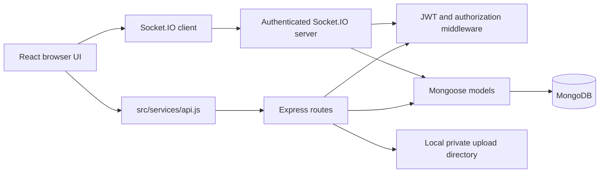

# ChatSphere — B.Tech Project Report

## Abstract

ChatSphere is a full-stack web application for private one-to-one and group communication. It combines an existing responsive React interface with a Node.js/Express API, MongoDB persistence through Mongoose, JWT-based authentication, and Socket.IO events. The application supports account/profile operations, message history and delivery-related interactions, group administration, authenticated attachment delivery, and a backend-recorded payment demonstration. Automated tests and a Vite production build validate local code paths. A live MongoDB deployment was not configured during this project session, so live multi-user and persistence claims remain pending. The payment interface is simulation only and does not transfer money.

## 1. Problem statement

Small teams and communities often rely on separate tools for conversations, group coordination, shared files, and transaction records. A cohesive web interface should make those interactions discoverable while enforcing identity, membership, and ownership rules on the server. A front-end-only prototype cannot provide durable history or meaningful access control; it requires a backend and persistent storage.

## 2. Objectives

1. Preserve the existing ChatSphere branding and responsive React interface.
2. Provide account registration, login, profile management, and protected backend routes.
3. Persist conversations/messages and enforce participant authorization.
4. Support group membership and administration with server-side permission checks.
5. Deliver text and attachment events over HTTP and authenticated Socket.IO.
6. Provide a clearly simulated payment and receipt workflow without financial credentials or transfers.
7. Document the architecture, configuration, data structures, limitations, and verification results.

## 3. Scope and requirements

### Functional requirements

- Register and authenticate a user, update profile, and sign out locally.
- Create/open direct conversations and groups, load message history, send/reply/react/edit/delete, and mark read state.
- Search conversations and message content, send selected files and recorded voice notes, and display notifications when browser permission is granted.
- Enforce member and group-admin authorization and protect downloads.
- Record demo transactions, expose owned transaction history, and show/print receipts.

### Non-functional requirements

- Password hashes, not clear-text passwords, are stored; protected APIs require bearer authentication.
- Validate request fields and reject unauthorized membership, administration, attachment, and transaction actions.
- Keep environment-specific credentials outside source control.
- Provide health/readiness reporting, useful failures when the database is unavailable, and a production frontend build.
- Preserve an adaptable layout and theme system across the existing interface.

## 4. Technology stack

| Layer | Technology |
| --- | --- |
| User interface | React 18, React Router 6, Vite, CSS, Lucide icons |
| HTTP backend | Node.js, Express 4 |
| Database | MongoDB with Mongoose 8 |
| Authentication | JSON Web Tokens and bcryptjs |
| Live events | Socket.IO server/client |
| Uploads | Multer with a MIME allow-list and 10 MB size cap |
| Tests | Node.js built-in test runner |

## 5. System design

The frontend calls REST endpoints through one API service and attaches a bearer token for protected calls. Socket connections carry the JWT in the Socket.IO auth payload. A requested conversation-room join is checked against the conversation's current member list. Message creation is persisted before the server broadcasts events; a client-generated message ID and compound unique index allow duplicate retries to return the existing record instead of storing a second copy.

## 6. Data model

- **User:** normalized unique email, bcrypt hash, display name, avatar/status, last-seen timestamp, and audit timestamps. Public serialization removes the password hash.
- **Conversation:** direct/group type, member references, name/image, last-message summary, and group admin/mute/pin metadata.
- **Message:** conversation and sender references, text/type, optional reply reference and attachment metadata, reactions, read-by users, delivery status, client idempotency ID, and timestamps.
- **Transaction:** sender/recipient references, USD amount and note, server-generated demo reference, status, explicit demo mode, and timestamps.

Indexes and constraints are detailed in [DATABASE_DESIGN.md](./DATABASE_DESIGN.md).

## 7. Implementation

### Authentication

Registration validates name/email/password, normalizes the email, hashes the password using bcrypt, and handles duplicate email conflicts. Login verifies a password hash and signs a JWT using a configured secret. The authentication middleware validates the JWT then loads the user; invalid tokens return 401 while database errors flow to the API error handler. Login/register have process-local IP rate limits. JWTs are currently stored in browser `localStorage`, and server logout is an acknowledgement rather than token revocation.

### Conversations, groups, and sockets

The API lists a user's conversations, creates/finds direct conversations, stores message replies/reactions/edits/deletions/read state, and exposes group membership/admin actions. Access is checked against MongoDB participants before protected message and file operations. Socket.IO requires a token, authorizes room entry, relays typing and persisted change events, and supports a disconnected/reconnecting client state. Online/offline presence beyond the current connection indicator is not implemented.

### Attachments and payments

Uploads are accepted only for an allow-list of image/document/audio MIME types and below 10 MB. Metadata is stored with a message; bytes remain in a local upload folder. Downloads require current conversation membership. The payment API validates a sender/recipient/amount/note, creates a server-referenced pending demo transaction, and exposes sender-authorized simulated verification. Receipts can be printed or saved as PDF through the browser print dialog. No card/bank secrets are requested; no real transaction occurs.

## 8. Security and reliability

Implemented safeguards include bcrypt hashing, environment-only JWT secrets, non-disclosure of password hashes, authenticated REST and Socket.IO, membership/admin/ownership checks, escaped search expressions, bounded message/upload sizes, upload MIME allow-list, rate limits, security response headers, idempotent message persistence, and 503 responses for database-dependent routes when MongoDB is unavailable.

Remaining risks include localStorage token exposure if XSS is introduced, process-local rate limits, lack of durable private cloud storage and malware scanning, no distributed Socket.IO adapter/presence subsystem, and no server-side JWT revocation. A deployment requires HTTPS, hardened headers/CSP, durable storage, shared throttling, monitoring, backups, and production configuration. See the [security and deployment notes](../README.md#security-and-deployment-limits).

## 9. Testing and results

The project's checked-in automated coverage uses Node's built-in test runner. At the time of delivery:

- `npm.cmd run build` (project root): **passed**.
- `npm.cmd test` (from `backend\`): **18 tests passed**.
- Degraded-mode backend smoke test: `/api/health` reports `degraded`, `/api/health/database` returns 503, and database-dependent API returns 503 with an explicit error.
- Backend JavaScript `node --check`: **passed**.
- Workspace diagnostics for the changed frontend files: **no errors reported**.
- Root `npm.cmd test`: not applicable; the root package intentionally has no test script. Run tests from `backend\`.
- Live MongoDB/two-account integration: **not run**, because no connection URI/test accounts were supplied.

The tests cover password/token helpers, authentication middleware failure handling, conversation/group access helpers, and rate limiter behavior. A build or unit-test pass does not prove the database-backed HTTP, Socket.IO, upload, or payment paths have passed a live integration test. See [TESTING.md](./TESTING.md) for a manual smoke-test plan.

## 10. Results

The existing branded frontend remains in place and builds for production. Backend routes/models provide the implemented application flows without introducing fake MongoDB records or inventing credentials. Message search has a conversation-scoped API and frontend control; demo transaction state and references are controlled by the backend. Documentation now records local start-up commands, environment settings, API/data design, and implementation status. Live persistence and real-time multi-user behavior remain conditional on user-configured MongoDB.

## 11. Limitations

- MongoDB is not configured in the current workspace; live persistence and multi-user authorization have not been verified here.
- Group image upload, online/offline presence, cross-device preferences/unread notification settings, email recovery, OAuth, and voice/video calls are not complete.
- Uploads are local-disk and MIME-metadata validated, not content-scanned; production storage is not ready.
- Payment is a clearly marked simulation, USD-only, and cannot transfer money.
- Signed-out screens may show local demo data; it is not live server data.

## 12. Future enhancements

1. Add integration tests using an isolated MongoDB test database and two authenticated clients.
2. Implement online presence with multi-device socket tracking and privacy preferences.
3. Add secure group image upload and private object storage with content validation/scanning.
4. Move sessions to appropriately protected HttpOnly cookies and add token revocation/password reset.
5. Persist cross-device notification/privacy settings and implement reliable notifications.
6. Integrate a legitimate payment provider only with server-to-server verification and provider-specific compliance.
7. Add provider-backed OAuth, email delivery, and calling only after configuration and threat review.
8. Prepare deployment pipelines, backups, observability, and load/security testing.

## References

- [API and Socket.IO reference](./API_DOCUMENTATION.md)
- [MongoDB schema](./DATABASE_DESIGN.md)
- [Architecture](./SYSTEM_ARCHITECTURE.md)
- [Verification guide](./TESTING.md)
- [Feature checklist](../BACKEND_IMPLEMENTATION_CHECKLIST.md)
